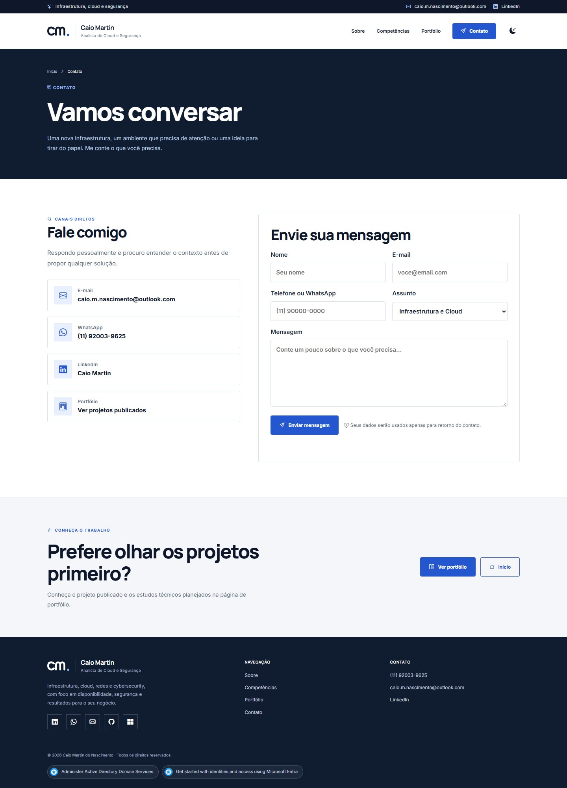
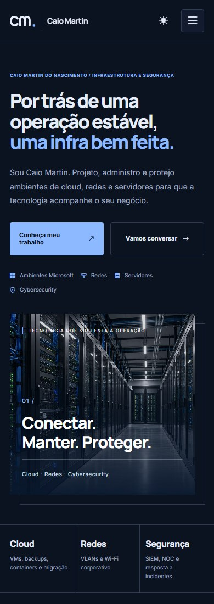

<p align="left">
  <picture>
    <source media="(prefers-color-scheme: dark)" srcset="docs/images/logo-dark.png">
    
  </picture>
</p>

# Portfólio profissional — Caio Martin

Site estático em HTML, CSS e JavaScript, com GitHub Pages e domínio próprio: https://caiomartin.dev.

## Prévia do site

Capturas da versão local em revisão, atualizadas em **12/10/2026**, com a marca vetorial usada no cabeçalho do site. Incluem a nova imagem de servidores e o formulário de contato sem anexos. A versão publicada pode diferir até o próximo deploy.

### Página inicial — tema escuro


<details>
  <summary>Ver a página inicial no tema claro</summary>


</details>

### Portfólio


<details>
  <summary>Ver a página de contato</summary>



</details>

### Versão mobile

<p align="center">
  
</p>

## Desenvolvimento local

Requer Node.js 22 ou superior e npm. As páginas também podem ser abertas diretamente, mas o servidor local é recomendado para testar a navegação e o formulário.

```bash
npm ci
npm run serve
```

Acesse http://127.0.0.1:4173. Fontes Inter e Manrope e Bootstrap Icons são carregados por CDN; as imagens são locais.

## Estrutura

- `index.html`: apresentação, competências e frentes de atuação.
- `portfolio.html`: carrossel e lista de projetos, com conteúdo inicial no HTML.
- `projeto-portfolio.html`: caso documentado do próprio site, com contexto, implementação e evidências.
- `contato.html`: canais diretos e formulário.
- `404.html`: página de erro com caminhos a partir da raiz, inclusive para URLs aninhadas.
- `styles.css`: tokens de tema, componentes e responsividade, sem os estilos obsoletos do layout anterior.
- `script.js`: menu, animações progressivas, carrossel e formulário.
- `theme.js`: detecção do tema do sistema e preferência do visitante.
- `projects.js`: fonte única dos projetos e estudos.
- `scripts/`: geração do conteúdo, validação de referências e montagem do pacote de publicação.
- `cypress/e2e/`: testes de páginas, tema, formulário, navegação, recursos, responsividade, fallback e acessibilidade.
- `docs/images/`: logo e prints usados neste README; esses arquivos não entram no pacote de publicação do site.

## Atualizar projetos

Edite `projects.js` e execute:

```bash
npm run generate:projects
npm run validate
```

A geração atualiza os blocos delimitados por `projects:carousel` e `projects:posts` em `portfolio.html`. Faça commit do HTML atualizado junto com os dados. O validador rejeita conteúdo gerado desatualizado.

Um projeto publicado pode ter `url`, `cta`, `imageAlt` e `tags`. Estudos sem evidências de execução usam `status: "planned"`, sem URL, e aparecem como “Estudo planejado”. As imagens dos estudos são ilustrativas. Para publicar um case real, acrescente contexto, contribuição, evidências e resultados verificáveis; não apresente um estudo planejado como implantação concluída.

O navegador recebe HTML já preenchido. O JavaScript acrescenta controles ao carrossel, anuncia mudanças e bloqueia foco nos slides ocultos. Se os scripts falharem, o conteúdo e a navegação continuam disponíveis.

## Formulário

O envio usa a API do Web3Forms e um honeypot contra spam. O código valida os campos obrigatórios, impede envios simultâneos, interrompe requisições após 15 segundos e preserva a mensagem em caso de erro.

A chave de acesso no HTML é a chave pública do formulário, necessária para o serviço. Não coloque credenciais privadas neste repositório. Sem JavaScript, o envio fica desativado e a página orienta o visitante a usar e-mail ou WhatsApp.

Os testes interceptam ou simulam a API. Não enviam mensagens reais.

## Tema e acessibilidade

O tema acompanha `prefers-color-scheme`; o visitante pode escolher outro tema pelo botão no cabeçalho. A preferência é salva em `localStorage` (`cmn-theme`) e sincronizada entre abas. Voltar ao tema do sistema remove a preferência salva.

O CSS mantém conteúdo visível por padrão, foco por teclado e respeito a `prefers-reduced-motion`. O menu fecha com Escape e devolve o foco ao botão. A suíte usa axe-core para verificar regras automatizáveis de WCAG AA; essa verificação complementa a revisão manual e não certifica acessibilidade completa.

## Validação e testes

```bash
npm run validate
npm run test:static
npm run build
npm run serve:dist
```

Em outro terminal:

```bash
npm run cypress:artifact
npm audit
```

O servidor do pacote usa http://127.0.0.1:4174. Para testar a fonte em 4173, use `npm run cypress:local`. O comando `npm run cypress:live` usa `CYPRESS_BASE_URL` quando configurado.

A validação confere arquivos obrigatórios, referências locais em HTML e CSS, caminhos da 404, dados estruturados e consistência dos projetos. O build usa a lista explícita de arquivos em `scripts/site-files.mjs`, inclui `theme.js` e não publica dependências, testes ou metadados Git.

A suíte inclui cenários de sucesso e falha do formulário, navegação por teclado, carrossel, tema, largura de 320 a 1440 px e conteúdo disponível quando os scripts falham.

## Publicação

```text
feature → PR para Develop → PR para main → deploy no GitHub Pages
```

Nos PRs, o CI valida a fonte, monta o pacote em `dist/` e testa esse pacote. Em `main`, os testes também rodam antes do deploy; a publicação usa o mesmo artefato validado. Depois há uma verificação do site publicado.

Configure `Settings > Pages > Source` como `GitHub Actions`. A pasta `dist/` é gerada e ignorada pelo Git.

## Conteúdo e SEO

O site inclui canonical, Open Graph, dados estruturados `Person`, favicon, robots e sitemap. A 404 usa `noindex`. Apenas a imagem realmente usada na abertura da home é pré-carregada; as imagens dos projetos têm carregamento sob demanda.

Os títulos oficiais das credenciais Microsoft permanecem em inglês. Analytics não está configurado e depende da escolha de um serviço e da conta do proprietário.
